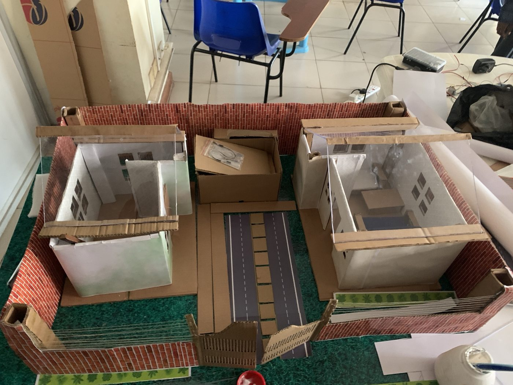
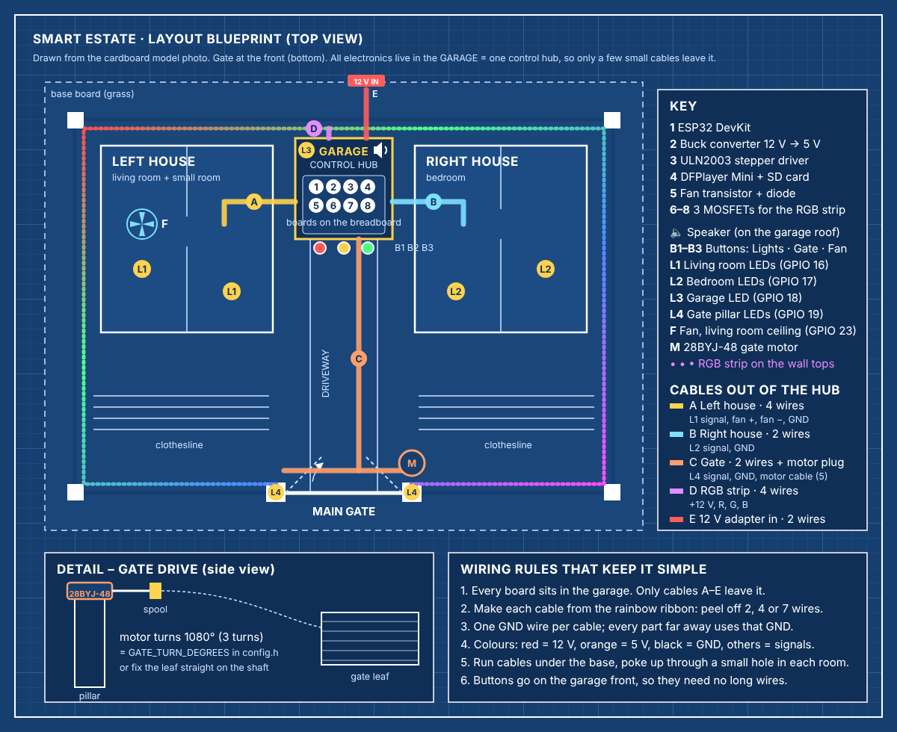
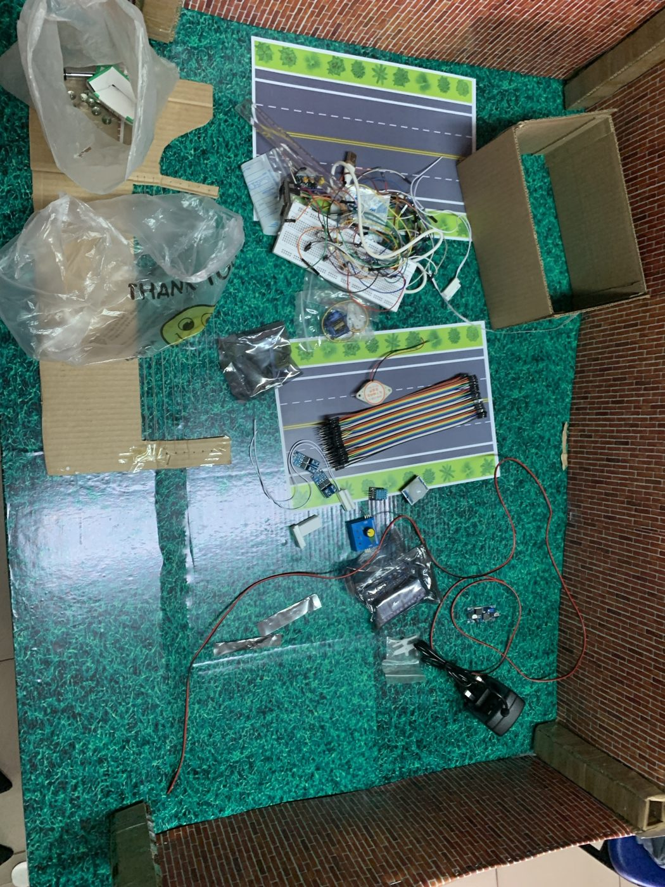

# 🏡 Smart Estate

An **ESP32 smart home estate model** with a web dashboard, **Alexa**, **voice commands**, **buttons**,
a **talking speaker** and online remote control. It runs on the cardboard model below:
two houses, a garage, a driveway and a motor-driven gate.



## What it does

| Part | What it does | Control it with |
|---|---|---|
| 💡 **Building lights** | LEDs in the living room, bedroom, garage and on the gate pillars. Dimmable | App, voice, Alexa, Lights button |
| 🚪 **Gate motor** | Stepper turns **1080°** (3 turns) to open, back to close. Pick any angle in `config.h` | App, voice, Alexa, Gate button |
| 🌀 **Fan** | 3 speeds, breeze mode, off-timer. No sensor needed | App, voice, Alexa, Fan button |
| 🌈 **RGB strip** | Glows around the walls as soon as the estate has power, shows what's happening, any colour, effects | App, voice, Alexa, BOOT button |
| 🔊 **Speaker** | Says every change out loud in real time: "Gate opening", "Fan speed two", "Welcome home!" | Automatic, volume by app or voice |
| 🎬 **Scenes** | Welcome home · Good night · Party · Doorbell | App, voice, Alexa |
| 🗣 **Alexa** | "Alexa, turn on Gate", "Alexa, set Strip Light to blue". No skill needed | |
| 🎙 **Voice in the browser** | "open the gate", "fan speed three", "dim the bedroom to 30 percent" | |
| 🌍 **Online** | Control from anywhere through MQTT, or run everything in the **Wokwi** simulator | |

📐 **Blueprint and simplified wiring: [docs/BLUEPRINT.md](docs/BLUEPRINT.md)**



## Repository layout

```
firmware/smart_estate/     ESP32 Arduino sketch
  smart_estate.ino         main program (sensors, automation, web, Alexa, MQTT)
  config.h                 pin map, gate angle (1080°), fan speeds, buttons  ← edit this
  secrets.example.h        copy to secrets.h and add Wi-Fi + Home ID
  webapp.h                 the dashboard, packed for the ESP32 (generated)
webapp/                    the web app (index.html, style.css, app.js, pictures)
sdcard/mp3/                the speaker's voice clips – copy to the DFPlayer's micro-SD card
wokwi/                     diagram.json + files to run the firmware in the Wokwi simulator
tools/build_webapp.py      packs /webapp into firmware/smart_estate/webapp.h
tools/make_voice_clips.py  makes the speaker clips (only if you want other words)
docs/BLUEPRINT.md          layout blueprint, simplified wiring, pin table, build order
docs/ALEXA_AND_VOICE.md    Alexa setup, voice phrases, buttons, all commands
docs/ONLINE_AND_SIMULATOR.md   GitHub Pages, Wokwi, MQTT remote control
.github/workflows/         auto-compile check + GitHub Pages deploy
```

## Quick start (Arduino IDE on your PC)

1. **Get the code:** on GitHub click **Code → Download ZIP** (or `git clone https://github.com/Angeldev256/smarthome`) and unzip it.
2. **Install the Arduino IDE 2** from arduino.cc.
3. **Add the ESP32 boards:** *File → Preferences → Additional boards manager URLs*:
   `https://espressif.github.io/arduino-esp32/package_esp32_index.json`
   Then *Tools → Board → Boards Manager* → install **esp32 by Espressif Systems**.
4. **Install the libraries:** *Sketch → Include Library → Manage Libraries* and install:
   * `ArduinoJson` (Benoit Blanchon, v7)
   * `Espalexa` (Christian Schwinne)
   * `PubSubClient` (Nick O'Leary)
   * only for a 3-wire WS2812 strip: `Adafruit NeoPixel`
5. **Add your Wi-Fi:** in `firmware/smart_estate/` copy `secrets.example.h` to **`secrets.h`** and fill in `WIFI_SSID`, `WIFI_PASSWORD` and a unique `HOME_ID`.
6. Open `firmware/smart_estate/smart_estate.ino`, choose *Tools → Board → **ESP32 Dev Module***, pick the COM port, and click **Upload**.
   (If it sticks on `Connecting....`, hold the **BOOT** button on the ESP32 until upload starts.)
7. Open the *Serial Monitor* at **115200**. It prints the address, e.g. `http://192.168.1.50`. Open it on your phone, or use **http://smartestate.local**.
8. Copy `sdcard/mp3` onto the DFPlayer's micro-SD card. The estate says *"Smart estate is online"* when it starts.
9. Say **"Alexa, discover devices"**.

Wire it up first using **[docs/BLUEPRINT.md](docs/BLUEPRINT.md)**. To change how far the gate turns, edit
`GATE_TURN_DEGREES` in `firmware/smart_estate/config.h` (1080 = three turns).

## The web app

* **On the ESP32:** `http://smartestate.local`. It switches to local mode automatically.
* **Online:** GitHub Pages (see [docs/ONLINE_AND_SIMULATOR.md](docs/ONLINE_AND_SIMULATOR.md)). Choose ⚙ → *Online* to reach the model through MQTT from anywhere.
* **Demo:** with no hardware it runs a simulated estate with Rain, Motion, Car and Door buttons, so you can present the project from any laptop.

It has a live top-down map of the estate (lights glow, the gate swings as the motor turns, the fan spins at its speed,
the strip glows in its colour), dimmers, fan speed buttons, colour swatches, scenes, an activity log,
a microphone button for voice, and the blueprint.

If you change anything in `webapp/`, run `python3 tools/build_webapp.py` so the ESP32 copy is updated.

## API (for your own apps)

| Request | Result |
|---|---|
| `GET /api/state` | JSON with every sensor and device |
| `GET or POST /api/cmd?device=gate&value=open` | send a command, returns the new state |

Devices: `living`, `bedroom`, `garage_light`, `outdoor`, `all_lights`, `gate`, `fan`, `fan_timer`, `strip`, `strip_color`,
`strip_effect`, `strip_brightness`, `volume`, `announce`, `say`, `doorbell`, `scene`.
Examples: `gate=open`, `gate=stop`, `living=40`, `fan=3`, `fan=breeze`, `strip_color=#ff8800`, `scene=party`.
The full list is in [docs/ALEXA_AND_VOICE.md](docs/ALEXA_AND_VOICE.md). The same commands work over MQTT
(`smartestate/<HOME_ID>/cmd`) and in the Serial Monitor (`gate open`).

## The parts



ESP32 · breadboard + rainbow jumper ribbon · LEDs + resistors · 28BYJ-48 stepper + ULN2003 board (gate) ·
small DC fan + NPN transistor + 1N4007 · RGB strip + 3 MOSFETs · DFPlayer Mini + speaker + micro-SD ·
3 push buttons · buck converter · 12 V 2 A adapter.
