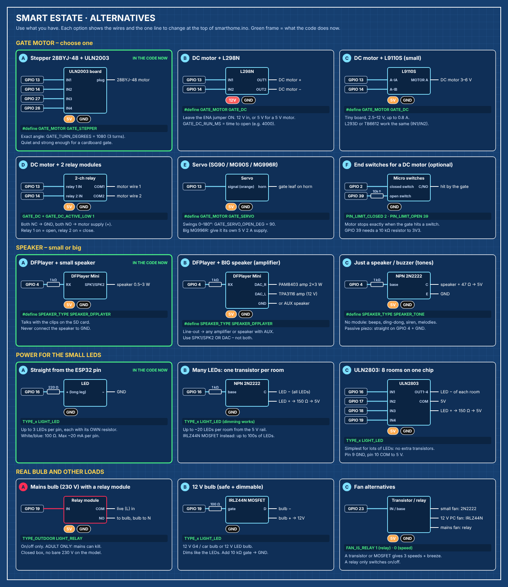

# Alternatives: use the parts you have

Every option below works with the same `smarthome.ino`. You only change **one or two lines in PART 1**
at the top of the file, and wire it as shown.

*(Vector version for printing: [blueprint-alternatives.svg](blueprint/blueprint-alternatives.svg))*

---

## 1. Gate motor

| Option | Change in PART 1 | Wiring | Good for |
|---|---|---|---|
| **A. Stepper 28BYJ-48 + ULN2003** *(default)* | `#define GATE_MOTOR GATE_STEPPER` | GPIO 13/14/27/26 → IN1–IN4, board + → 5V, − → GND | Exact angle: **1080°** or any number in `GATE_TURN_DEGREES` |
| **B. DC motor + L298N** | `#define GATE_MOTOR GATE_DC` | GPIO 13 → IN1, GPIO 14 → IN2, OUT1/OUT2 → motor, 12V (or 5V) + GND, **ENA jumper on** | Strong gear motors, 6–12 V |
| **C. DC motor + L9110S** | `#define GATE_MOTOR GATE_DC` | GPIO 13 → A-IA, GPIO 14 → A-IB, MOTOR A → motor, VCC 5V, GND | Small yellow "TT" gear motors, 3–6 V |
| L293D / TB6612FNG | `#define GATE_MOTOR GATE_DC` | same as L298N (IN1, IN2). TB6612: also STBY and PWMA → 3V3 | |
| **D. DC motor + 2 relays** | `GATE_DC` and `#define GATE_DC_ACTIVE_LOW 1` | GPIO 13 → relay 1 IN, GPIO 14 → relay 2 IN. Motor wires on COM1 and COM2. Both NC → GND, both NO → motor supply + | When you only have relays |
| **E. Servo** (SG90, MG90S, MG996R) | `#define GATE_MOTOR GATE_SERVO` | GPIO 13 → orange, red → 5V, brown → GND | A gate leaf that swings 0–180° (`GATE_SERVO_OPEN_DEG`) |

**DC motor settings**
* `GATE_DC_RUN_MS` = how long the motor runs to open the gate (try 4000 = 4 s, then adjust). Closing uses the same time.
* Gate opens the wrong way? `GATE_REVERSE 1` (or swap the two motor wires).
* **Optional end switches (F)** so the motor stops exactly at the ends: a micro switch from GPIO 2 to GND for "closed"
  (`PIN_LIMIT_CLOSED 2`), and one from GPIO 39 to GND for "open" (`PIN_LIMIT_OPEN 39`, plus a 10 kΩ resistor from GPIO 39 to 3V3).
  Set `GATE_DC_RUN_MS` a little longer than needed. The motor stops early when a switch is pressed.
* A DC motor can't turn an exact 1080°. It runs for a time instead. If you need the exact angle, use the stepper.

## 2. Speaker

| Option | Change in PART 1 | Wiring | Sound |
|---|---|---|---|
| **A. DFPlayer + small speaker** *(default)* | `#define SPEAKER_TYPE SPEAKER_DFPLAYER` | GPIO 4 → 1 kΩ → RX, VCC 5V, GND, speaker (0.5–3 W, 4–8 Ω) on **SPK1 + SPK2** | Spoken words from the SD card |
| **B. DFPlayer + big speaker** | same as A | DFPlayer **DAC_R / DAC_L + GND** → amplifier input → speaker | Loud voice |
| **C. Just a speaker or buzzer** | `#define SPEAKER_TYPE SPEAKER_TONE` | GPIO 4 → 1 kΩ → NPN (2N2222) base, emitter → GND, speaker + 47 Ω between 5V and collector | Beeps, ding-dong, siren, little melodies (no SD card) |

**Big speaker amplifiers (option B):**
* **PAM8403** board (5 V, 2 × 3 W): L-in ← DAC_L, R-in ← DAC_R, GND ← GND, 5V from the 5 V rail. Speakers on L+/L− and R+/R−.
* **TPA3116** board (12 V, 2 × 50 W): same inputs, power from the 12 V adapter (use a 3 A or bigger adapter). For a really big speaker.
* **Any powered / Bluetooth speaker with an AUX input:** cut an AUX cable: tip ← DAC_L, ring ← DAC_R, sleeve ← GND.
* Use SPK1/SPK2 **or** DAC_L/DAC_R, not both.

**Plain speaker (option C):** a **passive piezo** can go straight on GPIO 4 and GND with no transistor. An *active* buzzer
(the kind that beeps on its own with a sticker on top) only makes one tone, so tunes won't work. Use a passive one.

## 3. Power for the small LEDs

| Option | Change in PART 1 | Wiring | How many LEDs |
|---|---|---|---|
| **A. Straight from the pin** *(default)* | `TYPE_x LIGHT_LED` | GPIO → resistor → LED + , LED − → GND | up to 3 per pin, each with its own resistor |
| **B. One transistor per room** | `TYPE_x LIGHT_LED` | GPIO → 1 kΩ → NPN base, emitter → GND. Each LED: 5V → resistor → LED → collector | ~20 per room (2N2222), 100s with an IRLZ44N MOSFET |
| **C. ULN2803 chip** | `TYPE_x LIGHT_LED` | GPIO 16–19 → IN1–IN4, pin 9 → GND, pin 10 (COM) → 5V. Each LED: 5V → resistor → LED → OUTx | ~20 per room, all 4 rooms on one chip |
| **D. 12 V LED strip pieces as room lights** | `TYPE_x LIGHT_LED` | like option B but with an IRLZ44N MOSFET and the strip + on 12 V | as long as the strip |

**Resistor for each LED**

| LED colour | from 3.3 V (option A) | from 5 V (options B, C) |
|---|---|---|
| red, yellow, orange, warm | 220 Ω | 220 Ω |
| white, blue, green | 100 Ω | 150 Ω |

All options still dim with the app, voice and Alexa, because the transistor follows the ESP32's PWM.

## 4. A real bulb

| Option | Change in PART 1 | Wiring | Notes |
|---|---|---|---|
| **A. Mains bulb (230 V / 120 V) + relay module** | e.g. `#define TYPE_OUTDOOR LIGHT_RELAY` | GPIO 19 → relay IN, VCC 5V, GND. **Live** wire from the plug → COM, NO → bulb → **neutral** | On/off only (no dimming) |
| **B. 12 V bulb + MOSFET** *(recommended for a model)* | `TYPE_x LIGHT_LED` | GPIO → 100 Ω → IRLZ44N gate, 10 kΩ gate → GND, drain → bulb −, bulb + → 12 V, source → GND | Safe and **dimmable**. 12 V G4 halogen, car bulb, or 12 V LED bulb |
| **C. Solid-state relay (SSR)** | `LIGHT_RELAY`, and `RELAY_ACTIVE_LOW 0` | GPIO → SSR input +, GND → input −. Mains through the SSR output like option A | Silent, on/off only |

* Most blue relay modules switch **on with LOW**. That's why `RELAY_ACTIVE_LOW 1` is the default.
  If your bulb is on when it should be off, set it to 0.
* Any of the four lights can be a relay bulb: `TYPE_LIVING`, `TYPE_BEDROOM`, `TYPE_GARAGE`, `TYPE_OUTDOOR`.

> ⚠️ **Mains electricity can kill.** Only an adult who knows mains wiring should connect a 230 V / 120 V bulb.
> Put the relay and every mains wire inside a closed plastic box, use a proper lamp holder and a plug with a fuse,
> and never leave bare mains wires on the cardboard model. For a school model, **option B (12 V bulb)** is much safer and looks the same.

## 5. Fan

| Option | Change in PART 1 | Wiring | Speed control |
|---|---|---|---|
| **Small DC fan + NPN** *(default)* | `FAN_IS_RELAY 0` | GPIO 23 → 470 Ω → 2N2222 base, fan between 5V and collector, 1N4007 across the fan | 3 speeds + breeze |
| Bigger fan + TIP120 | `FAN_IS_RELAY 0` | same, with 1 kΩ to the base | 3 speeds + breeze |
| 12 V PC fan + MOSFET | `FAN_IS_RELAY 0` | GPIO 23 → 100 Ω → IRLZ44N gate, fan − → drain, fan + → 12 V | 3 speeds + breeze |
| L9110S fan module | `FAN_IS_RELAY 0` | GPIO 23 → INA, INB → GND, VCC 5V | 3 speeds + breeze |
| Any fan through a relay (even a mains fan) | `FAN_IS_RELAY 1` | GPIO 23 → relay IN | on / off only |

## 6. RGB strip

| Option | Change in PART 1 | Wiring |
|---|---|---|
| **4-wire 12 V strip (+12V, R, G, B)** *(yours, default)* | `RGB_STRIP_TYPE RGB_ANALOG` | 3 × IRLZ44N: GPIO 25/33/32 → 100 Ω → gate, 10 kΩ gate → GND, drain → R/G/B, source → GND, strip + → 12 V |
| 4-wire strip with TIP120 instead of MOSFETs | `RGB_ANALOG` | GPIO → 1 kΩ → base, collector → R/G/B, emitter → GND |
| 3-wire 5 V WS2812 / NeoPixel strip | `RGB_STRIP_TYPE RGB_WS2812`, `STRIP_LED_COUNT` | GPIO 25 → 330 Ω → DIN, 5V, GND. Install **Adafruit NeoPixel**. |

## 7. Sensors

| Part | Alternative | Change |
|---|---|---|
| HC-SR04 (5 V) | **HC-SR04P / RCWL-1601** (3.3 V): no divider needed, VCC → 3V3 | nothing |
| PIR HC-SR501 | **HC-SR312 / AM312 mini PIR** (3.3 V, small): same OUT wire, VCC → 3V3 | nothing |
| Don't have one yet | switch it off: `USE_PIR 0`, `USE_SONAR_GATE 0`, `USE_SONAR_GARAGE 0` | |
