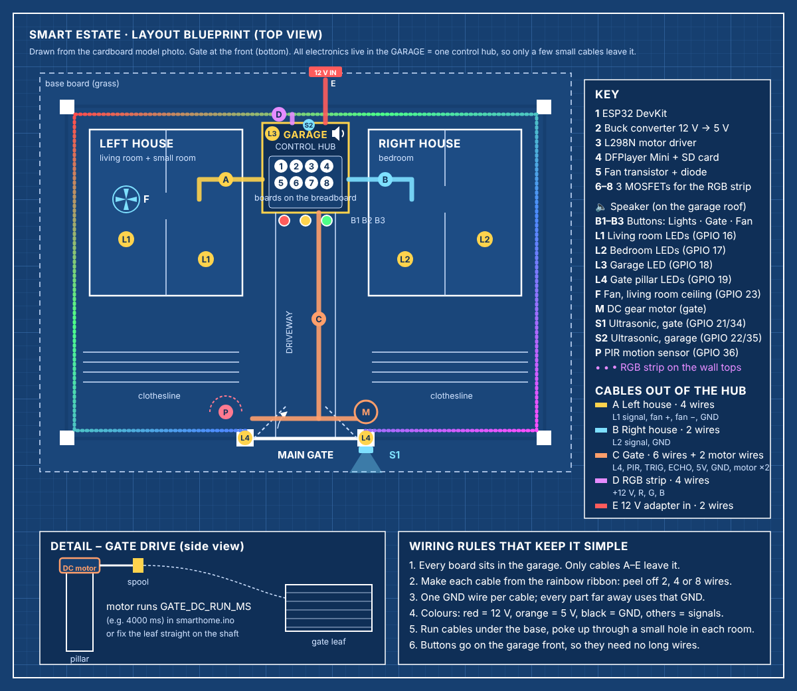
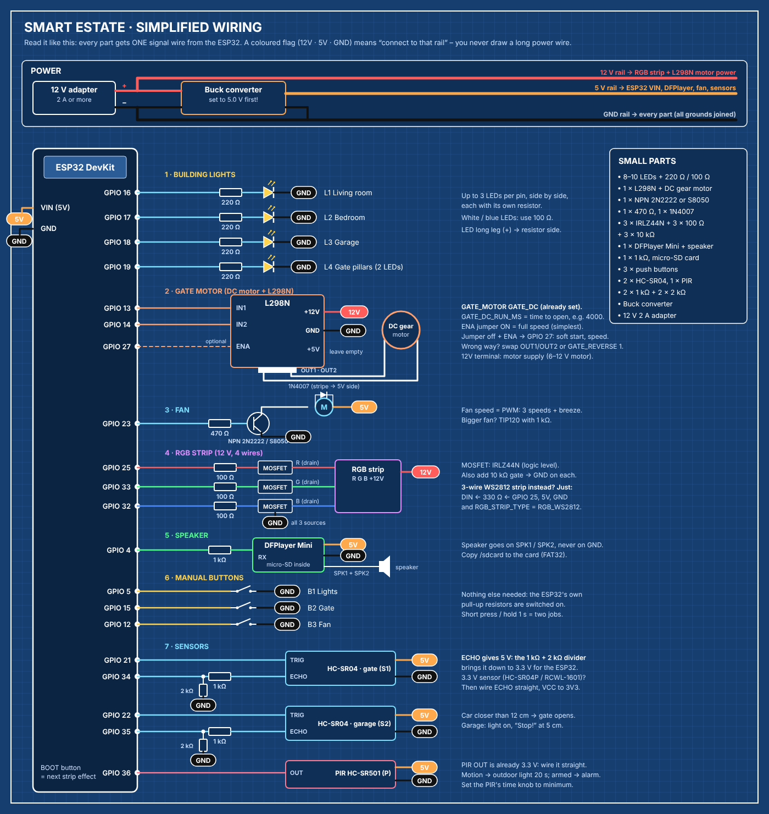

# Smart Estate blueprint and wiring

This page shows where every part goes on the model and how to wire it with as few wires as possible.
For other parts (DC motor, servo, big speaker, many LEDs, a real bulb) see **[ALTERNATIVES.md](ALTERNATIVES.md)**.

All settings and pins are at the top of **`firmware/smarthome/smarthome.ino`** (PART 1).

## 1. Layout (top view)



*(Vector version for printing: [blueprint-layout.svg](blueprint/blueprint-layout.svg))*

**The big idea: the garage is the control hub.** The ESP32, breadboard, buck converter, L298N board,
DFPlayer, transistors and the garage ultrasonic sensor all sit inside the garage box in the middle.
The buttons go on the garage front, next to the driveway. Only five small cables leave the garage:

| Cable | Goes to | Wires (peel them off the rainbow ribbon) |
|---|---|---|
| **A** | Left house | 4 wires: living-room LED signal, fan +, fan −, GND |
| **B** | Right house | 2 wires: bedroom LED signal, GND |
| **C** | Gate | 8 wires: gate-pillar LEDs, PIR OUT, ultrasonic TRIG, ultrasonic ECHO, 5V, GND + the 2 motor wires from OUT1/OUT2 |
| **D** | RGB strip | 4 wires: +12 V, R, G, B |
| **E** | 12 V adapter | 2 wires into the hub |

Run the cables **under the base board** and push each one up through a small hole into its room.

## 2. Wiring diagram



*(Vector version: [blueprint-wiring.svg](blueprint/blueprint-wiring.svg))*

How to read it: each part gets **one signal wire** from the ESP32. A coloured flag
(**12V**, **5V**, **GND**) means "connect to that rail on the breadboard", so you never run long power wires.

### Pin table

| Part | ESP32 pin | Other connections |
|---|---|---|
| Living-room LEDs (L1) | **GPIO 16** → 220 Ω → LED + | LED − → GND |
| Bedroom LEDs (L2) | **GPIO 17** → 220 Ω → LED + | LED − → GND |
| Garage LED (L3) | **GPIO 18** → 220 Ω → LED + | LED − → GND |
| Gate-pillar LEDs (L4) | **GPIO 19** → 220 Ω → LED + | LED − → GND |
| Gate DC motor (L298N) | **GPIO 13** → IN1, **GPIO 14** → IN2 (optional: ENA → **GPIO 27**) | +12V → 12 V, GND → GND, OUT1 + OUT2 → motor, ENA jumper on |
| Fan | **GPIO 23** → 470 Ω → NPN base | fan between 5V and collector, emitter → GND, 1N4007 across the fan |
| RGB strip red / green / blue | **GPIO 25 / 33 / 32** → 100 Ω → MOSFET gate | drains → strip R / G / B, sources → GND, strip + → 12 V |
| Speaker (DFPlayer Mini) | **GPIO 4** → 1 kΩ → DFPlayer **RX** | VCC → 5V, GND → GND, speaker on SPK1 + SPK2 |
| Ultrasonic at the gate (S1) | **GPIO 21** → TRIG, ECHO → 1 kΩ → **GPIO 34** (2 kΩ from GPIO 34 to GND) | VCC → 5V, GND → GND |
| Ultrasonic in the garage (S2) | **GPIO 22** → TRIG, ECHO → 1 kΩ → **GPIO 35** (2 kΩ from GPIO 35 to GND) | VCC → 5V, GND → GND |
| PIR motion sensor (P) | OUT → **GPIO 36** (the pin marked VP) | VCC → 5V, GND → GND |
| Button B1 – Lights | **GPIO 5** → button → GND | nothing else |
| Button B2 – Gate | **GPIO 15** → button → GND | nothing else |
| Button B3 – Fan | **GPIO 12** → button → GND | nothing else |
| BOOT button (on the ESP32) | GPIO 0 | already on the board: next strip effect |

### Power

```
12 V adapter ─┬─────────────────────────────► RGB strip +12 V, L298N +12V (motor power)
              └─► buck converter IN
                  buck converter OUT (set to 5.0 V with a meter BEFORE connecting!)
                        └─► 5 V rail ─► ESP32 VIN, DFPlayer VCC, fan, HC-SR04 ×2, PIR
GND: adapter −, buck −, ESP32 GND and every part's GND all joined on one rail
```

* The 12 V adapter needs **2 A or more** (the strip uses most of it).
* Never power the motor or the speaker from the ESP32's 3V3 pin. Always use the 5 V rail.
* You can leave the 12 V supply connected while you upload over USB.

## 3. Each part in detail

### Building lights (LEDs)
* Up to **3 LEDs per pin**, side by side, **each with its own resistor**.
* Yellow, red or warm LEDs: 220 Ω. White or blue LEDs: 100 Ω (they need more voltage).
* More LEDs per room, or a **real bulb**? See [ALTERNATIVES.md](ALTERNATIVES.md#3-power-for-the-small-leds).
* They dim smoothly: "dim the bedroom to 30 percent", or the sliders in the app.

### Gate motor: DC motor + L298N
* The L298N sits in the garage hub. **IN1 ← GPIO 13, IN2 ← GPIO 14.** Leave the **ENA jumper on** (full speed).
* **+12V** terminal → 12 V adapter (use the motor's voltage: 6–12 V), **GND** → GND rail (must be shared with the ESP32!).
  Leave the L298N's **+5V** terminal empty, the buck converter powers the ESP32.
* **OUT1 + OUT2** → the two motor wires (cable C, under the driveway to the gate).
* The motor runs for `GATE_DC_RUN_MS` to open, and the same time back to close:
  ```cpp
  #define GATE_MOTOR          GATE_DC   // already set
  #define GATE_DC_RUN_MS      4000      // measure: how long until your gate is fully open
  #define GATE_REVERSE        0         // 1 if it opens the wrong way (or swap OUT1/OUT2)
  #define GATE_AUTO_CLOSE_S   0         // e.g. 20 = close by itself after 20 s
  #define PIN_GATE_ENA        -1        // 27 = jumper off + ENA wired: soft start
  #define GATE_DC_SPEED       80        // % speed when ENA is wired
  ```
* **Finding the right time:** type `gate open` in the Serial Monitor and count how long it takes to open fully.
  Too long and the motor pushes at the end; too short and it stops early. For a perfect stop add the two optional
  end switches (see [ALTERNATIVES.md](ALTERNATIVES.md#1-gate-motor)).
* Fixing it to the gate: a gear motor with a crank arm or a spool + thread works well on a cardboard leaf.
* **Stepper (exact 1080°) or servo instead?** See [ALTERNATIVES.md](ALTERNATIVES.md#1-gate-motor).

### Fan (no sensor needed)
* Small DC motor fan, switched by an **NPN transistor** (2N2222 or S8050, base through 470 Ω).
* Always put a **1N4007 diode** across the fan (stripe towards 5V).
* Speeds: **off, 1, 2, 3**, plus **breeze** and an **off-timer**. If speed 1 doesn't start the fan, raise `FAN_DUTY_LOW`.

### RGB strip (4 wires): shows the estate is ON
* Your strip: **+12V, R, G, B**. Three logic-level MOSFETs (**IRLZ44N**): gate ← 100 Ω ← GPIO, 10 kΩ gate → GND,
  drain → strip colour wire, source → GND. Strip **+12V** → 12 V adapter.
* Glows **green** as soon as the estate has power. **Blue blinks** = connecting to Wi-Fi, **slow red blink** = no Wi-Fi,
  **orange pulse** = gate moving, **white flash** = doorbell / button, **fast red flashing** = ALARM.
* Effects: steady, breathe, rainbow, party. Any colour by app, voice or Alexa.

### Speaker: the estate talks
* **DFPlayer Mini** + small speaker. Only **one data wire**: GPIO 4 → 1 kΩ → DFPlayer RX. Speaker on **SPK1 + SPK2**.
* Copy the `sdcard/mp3` folder to a micro-SD card. See [sdcard/README.md](../sdcard/README.md).
* Big speaker, or no DFPlayer at all? See [ALTERNATIVES.md](ALTERNATIVES.md#2-speaker).

### Ultrasonic sensors (HC-SR04) ×2
* **S1 at the gate**: on the right gate pillar, looking out at the road. A car closer than **12 cm** → the gate opens
  ("Car at the gate. Opening."). It closes again **5 s** after the car has driven through.
  When security is armed the gate stays closed ("Security is on. The gate stays closed.").
* **S2 in the garage**: on the back wall, looking at the door. A car closer than **15 cm** = parked → garage light on,
  "Car parked". Closer than **5 cm** → "Stop! Stop!" and a red flash. The light goes off again when the car leaves.
* The **ECHO pin gives 5 V**: always put the **1 kΩ + 2 kΩ divider** in (or use a 3.3 V HC-SR04P / RCWL-1601).
* Change the distances in PART 1: `CAR_AT_GATE_CM`, `CAR_IN_GARAGE_CM`, `PARK_STOP_CM`, `GATE_CAR_CLOSE_S`.

### Motion sensor (PIR HC-SR501)
* In the compound, on the left gate pillar, looking at the driveway.
* Motion → **outdoor lights on for 20 s** (`MOTION_LIGHT_S`), "Motion detected".
* **Security armed** + motion → **alarm**: siren on the speaker, strip flashing red, red alert in the app. It stops when you
  disarm, press *Silence alarm*, say "stop the alarm", or after 60 s.
* Turn the PIR's **time** knob fully left (shortest) and the **sensitivity** knob to the middle.
  It needs about 30 s after power-on before it works.
* Not plugged in yet? Set `USE_PIR 0`, otherwise the loose pin can fake motion.

### Manual buttons
* A push button between the pin and GND. That's all.
* **B1 Lights:** press = all lights on/off, hold 1 s = all off.
* **B2 Gate:** press = open / close, hold 1 s = stop.
* **B3 Fan:** press = next speed, hold 1 s = off.
* **BOOT** button on the ESP32: next strip effect, hold = strip on/off.
* Different jobs? Edit `BUTTON_CFG` in PART 1, e.g. `{ 5, "security", "toggle", "off" }`.

## 4. Build order (test as you go)

1. Power only: adapter → buck converter, set it to **5.0 V** with a meter.
2. ESP32 on the breadboard, upload `smarthome.ino`, open the Serial Monitor (115200).
3. LEDs → type `living on`, `bedroom 30`.
4. Buttons → press them.
5. L298N + DC motor → `gate open`, `gate stop`, `gate close`. Adjust `GATE_DC_RUN_MS`.
6. Fan → `fan 1`, `fan 3`, `fan breeze`.
7. RGB strip → `strip red`, `strip rainbow`.
8. DFPlayer + SD card → `say hello`.
9. Ultrasonic sensors → type `state` and watch `gate_cm` / `garage_cm` change when you move your hand.
10. PIR → wave at it after 30 s: the outdoor lights come on. `security on`, wave again: alarm.
11. Fit everything into the garage and run cables A–E under the base.
