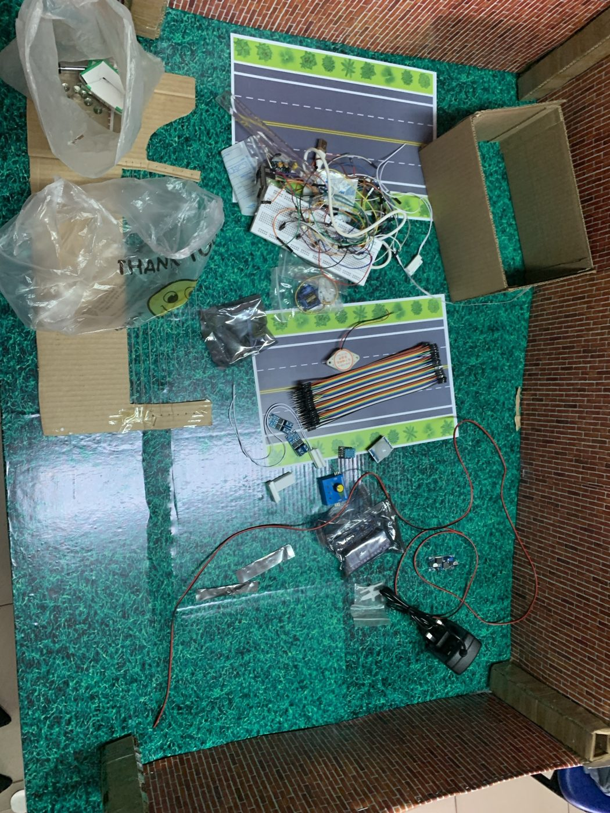

# Wiring guide – Smart Estate (ESP32)



## Parts list

| # | Part (from the kit photo) | Qty | Used for |
|---|---|---|---|
| 1 | ESP32 DevKit (ESP32-WROOM-32) | 1 | The brain – Wi-Fi, Alexa, web server |
| 2 | Breadboard + male/female jumper wires | 1 set | Connections |
| 3 | SG90 micro servo | 3 | Main gate, garage door, clothesline rain cover |
| 4 | Rain sensor ("raindrop" plate + blue LM393 board) | 1 | Detects rain → closes the clothesline cover |
| 5 | DHT11 temperature & humidity module (blue) | 1 | Climate reading + auto fan |
| 6 | HC-SR501 PIR motion sensor (white dome) | 1 | Outdoor light + intruder alarm |
| 7 | IR obstacle sensor module (blue, 3-pin) | 2 | Car at the gate, car inside the garage |
| 8 | Magnetic reed door contact (white, 2 parts) | 1 | Front door open/closed |
| 9 | Buzzer (round, 2 wires) | 1 | Alarm and beeps |
| 10 | 16×2 LCD with I2C backpack | 1 | Shows temperature, status and the IP address |
| 11 | LEDs (yellow/white) + 220 Ω resistors | 4 | Living room, bedroom, garage, outdoor lights |
| 12 | Small DC fan / motor + NPN transistor (2N2222 / TIP120) + 1N4007 diode | 1 | Cooling fan |
| 13 | DC-DC buck converter (small blue board) | 1 | 12 V adapter → 5 V for servos |
| 14 | 12 V power adapter | 1 | Power for the whole model |

> Tell us if any part in your kit is different (for example a relay instead of a transistor) and change the pin in `firmware/smart_estate/config.h`.

## Pin table

| Part | Part pin | ESP32 pin | Notes |
|---|---|---|---|
| DHT11 | DATA / S | **GPIO 4** | VCC → 3V3, GND → GND |
| PIR HC-SR501 | OUT | **GPIO 27** | VCC → **5V (VIN)**, GND → GND. Set the time pot to minimum |
| Rain sensor board | DO | **GPIO 34** | LOW when wet. Turn its blue pot to set how sensitive it is |
| Rain sensor board | AO | **GPIO 35** | Wetness level (0–100 % on the dashboard) |
| IR sensor – gate | OUT | **GPIO 32** | VCC → 3V3. LOW when a car is in front |
| IR sensor – garage | OUT | **GPIO 39 (VN)** | VCC → 3V3 |
| Door reed switch | wire 1 / wire 2 | **GPIO 33** / GND | Internal pull-up used. Magnet on the door |
| Servo – gate | orange (signal) | **GPIO 13** | red → **5 V from buck converter**, brown → GND |
| Servo – garage door | orange | **GPIO 14** | same power as above |
| Servo – rain cover | orange | **GPIO 26** | same power as above |
| Buzzer | + | **GPIO 25** | – → GND. Loud 12 V buzzers: switch through an NPN transistor |
| LED living room | + (long leg) via 220 Ω | **GPIO 16** | – → GND |
| LED bedroom | + via 220 Ω | **GPIO 17** | |
| LED garage | + via 220 Ω | **GPIO 18** | |
| LED outdoor | + via 220 Ω | **GPIO 19** | |
| Fan | transistor base via 1 kΩ | **GPIO 23** | Fan between 5 V and collector, diode across the fan |
| LCD I2C | SDA / SCL | **GPIO 21 / 22** | VCC → 5V, GND → GND. Address 0x27 (or 0x3F) |

## Power – read this before plugging in

```
12 V adapter ──► buck converter IN
                 buck converter OUT (adjust to 5.0 V with a meter!) ──► breadboard 5 V rail
                                                                         ├─► servo red wires (all 3)
                                                                         ├─► ESP32 VIN (5V pin)
                                                                         ├─► PIR VCC, LCD VCC, fan
ALL grounds (adapter –, buck OUT –, ESP32 GND, every sensor GND) joined together
```

* **Never** power three servos from the ESP32's 3V3 pin – the board will reset when they move.
* Set the buck converter to 5 V **before** connecting the ESP32.
* While uploading from the PC over USB you may leave the 12 V supply connected; grounds are shared.

## Where things go in the model

* **Gate servo** – glued under the right-hand gate leaf at the front wall; the horn pushes the leaf.
* **Garage servo** – inside the garage box roof, horn lifts the cardboard door.
* **Rain cover servo** – on the wall next to the left clothesline; a cardboard/plastic sheet on the horn swings over the lines. The rain sensor plate sits on the wall top, out in the "open".
* **IR gate sensor** – inside the gate pillar facing the driveway. **IR garage sensor** – back wall of the garage.
* **PIR** – front corner pillar looking at the compound. **Outdoor LED** – on the same pillar.
* **DHT11** – inside the living room. **Fan** – living room ceiling.
* **Reed switch** – living-room door frame, magnet on the door.
* **LCD** – on the front wall next to the gate, like an estate info panel.
